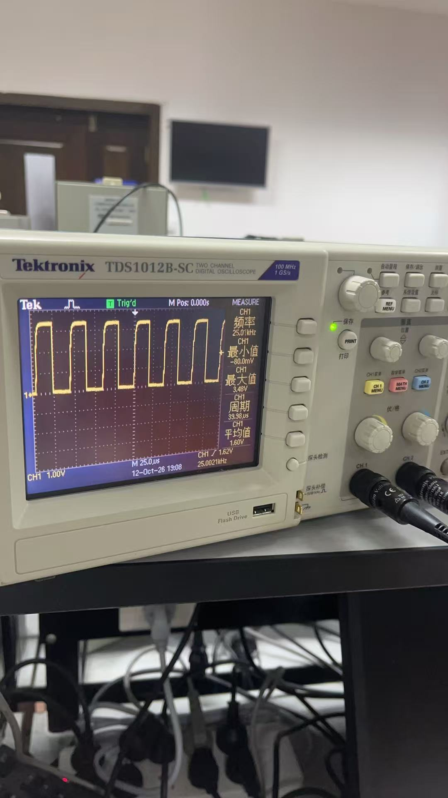
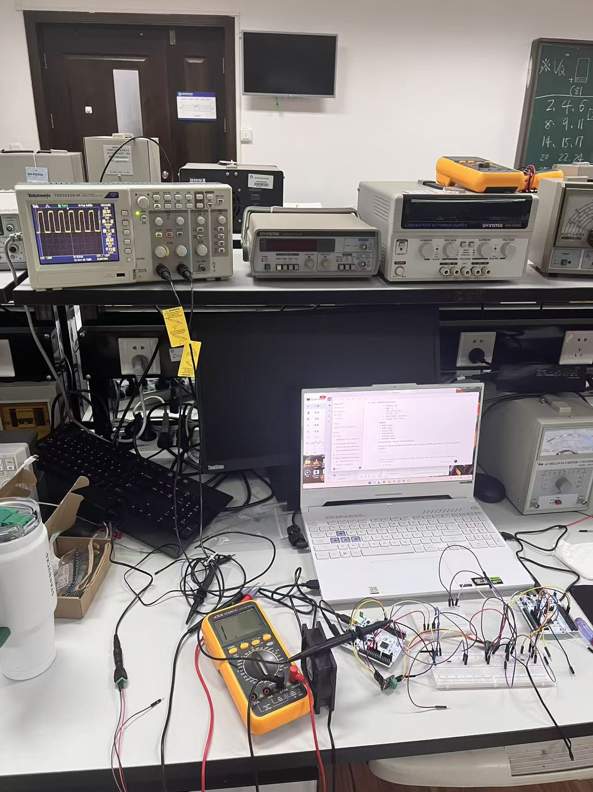

# Gate H3 PSU-00B 空载稳定性与残压记录（2026-10-12）

## 1. 本次范围

本记录用于关闭 `PSU12V-01` 的 `PSU-00B / H0 D-04`：适配器与风扇、NUCLEO、CAN Pal、INA260、面包板及其他项目负载保持隔离，只以数字万用表连接直流输出端，进行约 10 s 空载稳定性观察。

本次证据来源为现场执行人的结构化文字报告，没有同步照片、视频或自动采样日志。因此可用于项目分步准入和异常筛查，不作为计量校准、纹波、动态响应或额定带载能力证明。

## 2. 现场原始报告

> `PSU-00B：10秒范围 12.487～12.588 V，末值 12.588 V；无跳变；无异味、异响、异常发热；已断电。`

执行人随后补充：拔掉市电后，适配器指示灯仍亮；直流端用万用表测得约 `12.588 V` 并继续稳定约 10 s，随后开始下降，下降速度呈“先快、后慢、再快”的非线性过程，约 2 min 后电压释放完毕。

## 3. 判定

| 项目 | 现场结果 | 判定 |
|---|---:|---|
| 带电空载 10 s 范围 | `12.487～12.588 V` | PASS；跨度 `0.101 V`，约为末值的 `0.80%` |
| 10 s 末值 | `12.588 V` | 与既有约 `12.580 V` 静态证据一致 |
| 可见跳变 | 无 | PASS |
| 异味、异响、异常发热 | 无 | PASS |
| 断开市电后的残压 | 约 10 s 仍为 `12.588 V`，约 2 min 后释放完 | 记录为安全操作特性，不判为故障 |

`PSU-00B` 判定为 **PASS（2026-10-12）**，H0 `D-04` 判定为 **CLOSED（仅空载基本稳定性范围）**。

没有公开空载容差时，本记录不宣称适配器满足某个未经证实的 `±X%` 产品规格；通过依据是输出量级与铭牌/既有静态读数一致，10 s 内未见突跳，并且没有异味、异响或异常发热。

## 4. 残压解释与安全边界

万用表输入阻抗很高，空载时只从适配器输出端取极小电流；适配器内部的输入/输出储能电容因此可能在拔掉市电后继续维持指示灯和直流输出一段时间。控制器停止开关、指示灯导通区及电容放电共同作用时，电压下降不必呈单一指数曲线。本次现象与“空载储能缓慢释放”相符，但没有拆机、测电容或记录连续波形，不能把某个具体内部器件断言为唯一原因。

后续安全规则冻结为：

- 拔掉市电后仍把直流端视为带电，直到指示灯熄灭且万用表确认残压已经下降；
- 接线、改线前以直流档确认输出低于 `0.5 V`；
- 不用螺丝刀、导线或表笔短接输出端强制放电；
- 本记录不证明 3 A 带载、纹波、浪涌、保护动作或长期温升能力。

## 5. 下一授权点

`PSU-00B` 关闭后只授权执行 `FAN-00C` 延长线无源映射：适配器保持拔掉并与项目隔离，所有板卡和风扇均不接线，只使用万用表通断档确认延长线四个物理位置的一一对应关系及任意两线之间无短路。

## 6. FAN-00C 延长线无源映射结果

执行人把公头和母座的插接面同时朝向自己、防呆结构保持同向，并分别将两端从左至右临时编号为 `M1～M4`、`F1～F4`，随后报告：

> `FAN-00C：M1→F4，M2→F3，M3→F2，M4→F1；四路均稳定蜂鸣；不同针位之间均不蜂鸣；晃动无断续。`

| 检查 | 结果 | 判定 |
|---|---|---|
| 四路端到端连续性 | `M1→F4`、`M2→F3`、`M3→F2`、`M4→F1`，均稳定蜂鸣 | PASS；两个插接面同时正视时的镜像映射 |
| 不同针位隔离 | 均不蜂鸣 | PASS；未发现线间低阻短路 |
| 轻微晃动 | 无断续 | PASS；未发现可复现接触不良 |

`FAN-00C` 判定为 **PASS（2026-10-12）**。该结果证明当前延长线四根导体一一对应、没有检测到交叉并线或晃动断续；它不证明额定载流、绝缘耐压、长期弯折寿命，也尚未把四个物理位置绑定为 `GND / +12 V / Tach / PWM`。

下一步进入 `FAN-00D` 的接电前针脚身份确认。适配器继续保持拔掉并确认残压释放；只依据 4-wire 标准、防呆方向和无源连续性建立 `Pin 1～4` 功能，不按全黑导线的条纹猜测，也不在身份确认完成前上电。

现场执行人否决了剪掉延长线母座、重新剥线的初步口头方案：现有压接端子、防呆外壳和应力保护均完好，剪线会无谓引入机械强度、剥线损伤、重新绝缘和误标风险。该纠正被接受，现场未剪线。后续改用完整延长线加可拔插两针测试转接，仅连接 `Pin 1/GND` 与 `Pin 2/+12 V`；在风扇接入前先从延长线公头端实测端到端极性，`Pin 3/Tach`、`Pin 4/PWM` 保持空置。

## 7. FAN-00D-A 功能针位无源绑定

适配器保持未上电。现场将风扇四孔主母座与延长线四针公头按防呆方向插接，以风扇 PST 三针公头的电源触点为参考逐孔扫描延长线母座，报告：

> `FAN-00D-A：GND→F1，+12V→F2；各自唯一蜂鸣，交叉不蜂鸣；电源未上电。`

`FAN-00D-A` 判定为 **PASS（2026-10-12）**，冻结 `F1=GND`、`F2=+12 V`；本次功率验证中 `F3/F4` 均保持空置。该结果证明无源功能映射唯一且未检出交叉低阻，不证明带电极性、载流或风扇运行。

下一步只授权 `FAN-00D-B` 空载端到端极性确认：风扇与延长线分离，`F1/F2` 分别通过完整测试线接 DC 端子负/正极，`F3/F4` 留空；短时上电后在延长线公头验证 `Pin 2` 相对 `Pin 1` 为正的约 `12.5 V`，随后断电并确认残压低于 `0.5 V`。在该结果通过前不得插接风扇。

## 8. FAN-00D-B 空载端到端极性确认

风扇保持断开，延长线母座 `F1/F2` 分别接 DC 端子负/正极，`F3/F4` 空置。执行人报告：

> `FAN-00D-B：Pin2对Pin1=+12.588V，10秒范围12.588～12.588V；无跳变；F3/F4空置；已断电，残压<0.5V；风扇未接。`

`FAN-00D-B` 判定为 **PASS（2026-10-12）**：端到端极性为正，电压与适配器空载基线一致，10 s 内无可见跳变，断电残压满足安全阈值。

执行人同时观察到，接入 DC 端子和测试线后，断电电压从约 `0 V` 缓慢上升，没有复现适配器先前直接空载测量时先保持高电平再下降的曲线；最终仍低于 `0.5 V`。该现象暂登记为高阻条件下低幅残余电荷重分布/浮空感应的候选解释，不锁定机理；若后续超过 `0.5 V`、持续上升或影响改线安全，则重新 HOLD。

下一步只授权 `FAN-00D-C` 单只风扇约 10 s 独立上电；Node、PWM、Tach、Heater、INA260 均不得连接。

## 9. FAN-00D-C 单风扇短时独立上电

Node、PWM、Tach、Heater、INA260 均保持隔离，仅通过已验证的 `F1/GND`、`F2/+12 V` 给一只风扇供电。执行人报告：

> `FAN-00D-C：上电后立即起转；10秒内转动稳定；无异常噪声、振动、异味、发热；已断电，残压<0.5V。`

执行人同时观察到，气流由正面白色 Logo/开放叶片面吸入，从背面参数标签/支撑筋面吹出。该方向符合典型轴流机箱风扇结构，不表示供电反接；改变系统内气流方向应翻转风扇安装方向，而不是交换供电极性。

`FAN-00D-C` 判定为 **PASS（2026-10-12）**，`FAN-00D` 因而在“单风扇短时独立上电”范围关闭为 **PASS**。本结论不覆盖长期运行寿命、额定电流、堵转、PWM、Tach/PPR 或系统联合运行。

下一步只授权全断电的 `FAN-00E-A` PWM 物理孔位映射；适配器不得上电。

## 10. FAN-00E-A PWM 物理孔位映射

适配器未上电且残压 `<0.5 V`，风扇主母座保持与延长线公头连接。执行人从 PST 三针公头中与另外两针隔着空位的孤立 PWM 触点出发，扫描延长线母座 `F3/F4`，报告：

> `FAN-00E-A：PST孤立针PWM→F4；另一孔不蜂鸣；电源未上电，残压<0.5V。`

`FAN-00E-A` 判定为 **PASS（2026-10-12）**。结合此前电源针位和 PST 省略 Tach 的结构证据，完整映射冻结为 `F1=GND`、`F2=+12 V`、`F3=Tach`、`F4=PWM`。Tach 继续隔离。

下一步只授权 `FAN-00E-B`：风扇保持独立供电，Node 和其余外设均不连接，以 `F1/GND` 为参考测量 `F4/PWM` 开路直流电压；PWM 不得接入 GPIO。

## 11. FAN-00E-B PWM 开路电压与参考点纠正

首次报告 `7.681～7.683 V` 后，执行人立即识别出黑表笔误放在 `+12 V`，该值是电源线与 PWM 线之间的电位差，不能作为 PWM 对地电压，判为 **INVALID**。重新以 `F1/GND` 为参考测量，`F4/PWM` 稳定为 `4.850 V`。

有效值 `4.850 V` 低于 Intel 四线 PWM 风扇接口的 `5.25 V` 风扇侧上拉绝对上限，`FAN-00E-B` 判定为 **PASS（2026-10-12）**，`FAN-00E` 整体关闭为 **PASS**。这条证据同时保留了错误参考点被现场发现并纠正的过程，错误值不进入验收统计。

官方接口依据：<https://www.intel.com/content/dam/doc/design-guide/core-2-pentium-celeron-dual-core-guide.pdf>。

## 12. FAN-00F 驱动决策

ST 官方数据手册确认 `PC7` 是 `FT`（5 V tolerant）并支持 `TIM3_CH2`；FT 输入绝对上限为 `VDD+4.0 V`，当外部电压超过 `VDD+0.3 V` 时内部上拉/下拉必须关闭。Node A 正常约 `3.3 V` 供电时，实测 `4.850 V` 满足输入范围。Intel 给出风扇 PWM 最大 `5 mA` 下拉电流，ST 给出标准 GPIO 最大 `8 mA` 吸收/输出能力，电流能力亦满足当前接口族约束。

H3 受控实验阶段因此批准 `PC7/TIM3_CH2` 采用复用开漏、内部无上下拉的直连方案；Node A 必须先上电、风扇 12 V 后上电，关闭时顺序相反。Node A 未供电时不得让风扇 PWM 上拉进入 PC7；若最终系统无法硬件保证时序，则必须改用外部 NPN/NMOS 隔离。

ST 官方依据：<https://www.st.com/resource/en/datasheet/stm32f103rb.pdf>。

`FAN-00F` 判定为 **PASS（受控实验直连与时序约束范围）**。下一步只允许在风扇完全隔离时执行 `FAN-01` Node A `PC7/D9` 低压侧波形验证：用外部 `10 kΩ` 把 PC7 上拉到 Node A `3V3`，示波器以 Node A GND 为参考，预期约 25 kHz / 50%。

## 13. FAN-01 PC7 开漏空载波形

风扇、12 V、Tach、Heater 和 INA260 均保持隔离。Node A 断电时在 `D9/PC7` 与本板 `3V3` 之间接入外部 `10 kΩ` 上拉，示波器地夹接 Node A GND。无源预检为：

- `D9—3V3=9.982 kΩ`；
- `3V3—GND` 不蜂鸣；
- `D9—GND` 不蜂鸣。

执行人连续观察 10 s 后报告：

> `FAN-01：D9-3V3=9.982kΩ；3V3-GND/D9-GND均不蜂鸣；Vmax=3.48V，Vmin=-40mV，频率=25.03kHz，周期=40.02µs，占空比=50%；10秒稳定。`

原始照片屏显的当时瞬时自动测量为 `25.01 kHz / 39.98 µs / Vmax=3.48 V / Vmin=-80.0 mV / Vavg=1.60 V`，通道设置可见为 `CH1 1.00 V/div`、时基 `25.0 µs/div`。执行人补充说明，图上自动测量值在观察时会有几十毫伏摆动；因此 `-40 mV` 是人工结构化报告时的读数，`-80.0 mV` 是照片快照时的屏显，二者均按原始证据保留。波形平台、周期结构和 10 s 稳定性未见异常。

| 检查项 | 目标 | 结果 | 判定 |
|---|---:|---:|---|
| 上拉电阻 | 约 `10 kΩ` | `9.982 kΩ` | PASS |
| 频率 | `25.000 kHz` | 文字 `25.03 kHz`；照片 `25.01 kHz` | PASS |
| 周期 | `40.000 µs` | 文字 `40.02 µs`；照片 `39.98 µs` | PASS |
| 占空比 | `50%` | `50%` | PASS |
| 电平 | 3.3 V 上拉/近地下拉 | `Vmax=3.48 V`；`Vmin=-40～-80 mV` 观察量级 | PASS；小幅边沿过冲/欠冲与测量回路影响候选，不外推 EMC |
| 10 s 稳定性 | 无波形丢失/明显漂移 | 稳定 | PASS |

`FAN-01` 判定为 **PASS（PC7 开漏空载波形范围）**。

### 13.1 原始照片

| 文件 | 大小 | SHA-256 | 可支持事实 |
|---|---:|---|---|
| [`FAN-01_PC7_PWM_scope_25kHz_50pct_20261012.jpg`](FAN-01_PC7_PWM_scope_25kHz_50pct_20261012.jpg) | 148418 bytes | `593E750B8C49765B66170C65AAACE345F5FA91FE3DE29535D7FFFC23CB3F034D` | 示波器屏显、方波形态、频率/周期/电平/平均值快照 |
| [`FAN-01_bench_setup_20261012.jpg`](FAN-01_bench_setup_20261012.jpg) | 290143 bytes | `0430AE7353479BE68EC20EB30E6A83FFA2ED10158F0844514FA3B6476DC237AD` | 实验台整体布置、Node A/面包板/示波器测量环境 |

下一步为 `FAN-02A` 固定 50% 单风扇 PWM 联调。全断电后必须先拆除本步外部 `10 kΩ` 上拉，避免它与风扇内部 `4.850 V` 上拉并存；`F3/Tach`、Heater 和 INA260 继续隔离。

## 14. FAN-02A 固定 50% 单风扇联调

全断电后已拆除 `FAN-01` 的外部 `10 kΩ` 上拉。现场只建立以下连接：

- `Node A GND↔F1/GND↔PSU-`；
- `Node A D9/PC7↔F4/PWM`；
- `PSU+↔F2/+12 V`。

`F3/Tach`、PST 额外接口、Heater 和 INA260 均保持隔离。无源检查正常；Node A USB 先上电，确认稳定后才开启风扇 12 V，关闭时按相反顺序执行。执行人报告：

> `FAN-02A：外部10k已拆；无源检查正常；风扇起转正常；10秒稳定正常；PWM Vmax=4.92V、Vmin=-40mV、频率=25.02kHz、周期=40微秒、占空比50%；USB无断连重连；已按顺序断电。`

| 检查项 | 目标/边界 | 实测 | 判定 |
|---|---:|---:|---|
| 风扇起转与 10 s 运行 | 正常、无明显异常 | 正常并稳定 | PASS |
| PWM 高电平 | 风扇内部约 5 V 上拉，且 `<5.25 V` | `4.92 V` | PASS |
| PWM 低电平 | `<0.8 V` | `-40 mV` | PASS；近地小幅欠冲 |
| 频率 | `25.000 kHz` | `25.02 kHz` | PASS；约 `+0.08%` |
| 周期 | `40.000 µs` | `40 µs` | PASS |
| 占空比 | `50%` | `50%` | PASS |
| USB 稳定性 | 无断连/重连 | 无断连/重连 | PASS |
| 上/断电顺序 | Node 先上电、风扇后上电；关闭相反 | 已按顺序完成 | PASS |

`FAN-02A` 判定为 **PASS（固定 50% 单风扇短时电气/功能联调范围）**。该结果不外推为不同占空比的转速响应、低占空比停转、Tach/PPR、绝对转速、长期运行或最终装配通过。

下一步为 `FAN-02B` 受控占空比响应验证。必须先在风扇、12 V 和 PWM 与 Node A 完全隔离时准备及刷写测试镜像，并在重新接入风扇前验证镜像身份与低压侧输出；`F3/Tach`、Heater、INA260 继续隔离。
